<div align="center">


<br/>

<a href="https://nihal-protfolio.vercel.app"></a>

<p><sub>Computer Science Engineering student building AI-powered products end to end — from model to deployment.</sub></p>

<p>
  <a href="https://linkedin.com/in/nihal-hussain-cse"></a>
  <a href="https://nihal-protfolio.vercel.app"></a>
  <a href="https://github.com/nihalhussain555"></a>
  <a href="mailto:nihalhussain587@gmail.com"></a>
  
  
</p>

</div>

<p align="center"></p>

<div align="center"></div>
<br/>

<table width="100%">
  <tr>
    <td width="46%" valign="top" align="center"></td>
    <td width="54%" valign="top">
      <p>I am an <b>AI/ML engineer and MERN stack developer</b> from Tamil Nadu, India, studying B.E. Computer Science &amp; Engineering at Kalaignar Karunanidhi Institute of Technology (<b>CGPA 8.42 / 10.0</b>).</p>
      <p>My focus is the part most portfolios skip: taking models past the notebook into systems that hold up under real users — retrieval pipelines, LLM integration and multi-agent orchestration, delivered through React and Node services.</p>
      <p>
        <b>Building:</b> intelligent applications and AI-powered products, end to end<br/>
        <b>Exploring:</b> agentic AI, LLM steering, scalable software architecture<br/>
        <b>Experience:</b> AI/ML intern at DECODELABS — applied ML and NLP<br/>
        <b>Working style:</b> measurable accuracy, tested code, deployments that stay up
      </p>
    </td>
  </tr>
</table>

<p align="center"></p>

<div align="center"></div>
<br/>

<table width="100%">
  <tr>
    <td width="27%" valign="middle"><b>Programming Languages</b></td>
    <td width="73%"> </td>
  </tr>
  <tr>
    <td valign="middle"><b>Frontend</b></td>
    <td></td>
  </tr>
  <tr>
    <td valign="middle"><b>Backend</b></td>
    <td></td>
  </tr>
  <tr>
    <td valign="middle"><b>AI &amp; Machine Learning</b></td>
    <td>     </td>
  </tr>
  <tr>
    <td valign="middle"><b>Databases</b></td>
    <td></td>
  </tr>
  <tr>
    <td valign="middle"><b>Tools &amp; Platforms</b></td>
    <td></td>
  </tr>
</table>

<p align="center"></p>

<div align="center"></div>
<br/>

<table width="100%">
  <tr>
    <td width="44%" valign="top">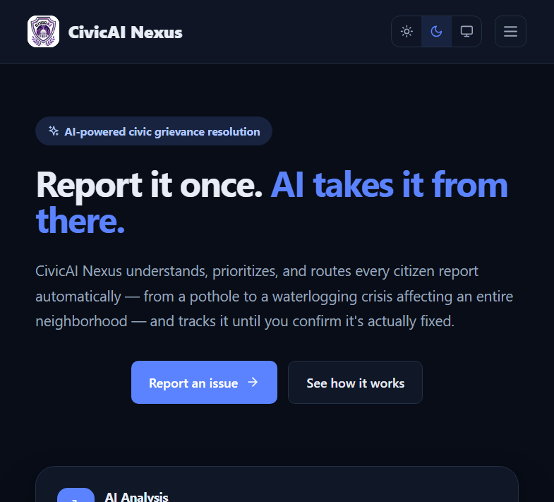</td>
    <td width="56%" valign="top">
      <h4>CivicAI Nexus</h4>
      <p>Predictive multimodal grievance intelligence platform. Citizens report in <b>Tamil, Hindi or English</b> by text, voice or photo; NLP classification, semantic similarity and RAG route each case to the right department, while predictive SLA tracking flags complaints at risk of missing their resolution deadline.</p>
      <p><code>Python</code> <code>React</code> <code>NLP</code> <code>RAG</code> <code>MongoDB</code></p>
      <p><a href="https://civicai-theta.vercel.app"><b>Live ↗</b></a> · <a href="https://github.com/nihalhussain555/CivicAI_Nexus"><b>Source ↗</b></a></p>
    </td>
  </tr>
  <tr>
    <td valign="top">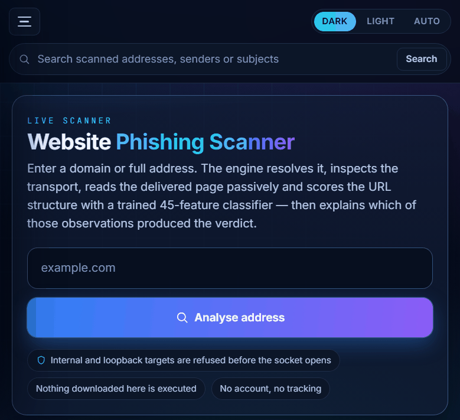</td>
    <td valign="top">
      <h4>AI Phishing Detector</h4>
      <p>Real-time cybersecurity console. A trained <b>45-feature classifier</b> scores URL structure while the engine reads the live TLS certificate, re-validates every redirect and statically parses the delivered HTML — then explains which signals produced the verdict. Ships with email, QR-code and claim-verification analyzers.</p>
      <p><code>Python</code> <code>Flask</code> <code>XGBoost</code> <code>Scikit-learn</code> <code>JavaScript</code></p>
      <p><a href="https://ai-phishing-detector-tnlt.onrender.com"><b>Live ↗</b></a> · <a href="https://github.com/nihalhussain555/AI-Phishing-Detector"><b>Source ↗</b></a></p>
    </td>
  </tr>
  <tr>
    <td valign="top">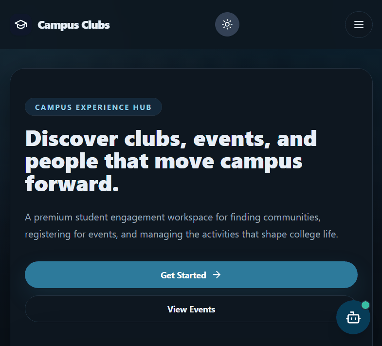</td>
    <td valign="top">
      <h4>Campus Clubs &amp; Events Management</h4>
      <p>Full-stack campus platform for club governance, event registration, digital ticketing and certificate issuance, secured with <b>JWT role-based access control</b> and an embedded conversational AI assistant.</p>
      <p><code>React</code> <code>Node.js</code> <code>Express</code> <code>MongoDB</code> <code>JWT</code></p>
      <p><a href="https://campus-clubs-events-management.vercel.app"><b>Live ↗</b></a> · <a href="https://github.com/nihalhussain555/Campus_Clubs_Events_Management"><b>Source ↗</b></a></p>
    </td>
  </tr>
</table>

<sub>More: [LaunchCrew](https://github.com/nihalhussain555/Launch-Crew) — autonomous multi-agent web app builder · [Fixon](https://github.com/nihalhussain555/Fixon) · [AI Voice Sales Bot](https://github.com/nihalhussain555/AI-Voice-Sales-Bot) · [MERKISYS](https://github.com/nihalhussain555/MERKISYS) · [GlobeTrotter](https://github.com/nihalhussain555/GlobeTrotter) · [P2P Learning Graph Tracker](https://github.com/nihalhussain555/Peer-to-Peer-Learning-Graph-Tracker) · [AI Food Waste Tracker](https://github.com/nihalhussain555/Ai-Powered-Food-Waste-Tracker) · [House Price](https://github.com/nihalhussain555/House_Price) · [Email Scam Detection](https://github.com/nihalhussain555/Email-Scam-Detection)</sub>

<p align="center"></p>

<div align="center"></div>
<br/>

<table width="100%">
  <tr>
    <td width="54%" valign="top" align="center"></td>
    <td width="46%" valign="top" align="center">
      <br/><br/>
      <br/><br/>
      <sub>Contribution, streak and follower figures update automatically.</sub>
    </td>
  </tr>
</table>


<details>
<summary><b>Most-used languages &amp; the stats-card recipe</b></summary>

<br/>

Primary languages across my public repositories, by code volume: **JavaScript · Python · Jupyter Notebook · CSS · HTML · TypeScript · C++**.

The shared `github-readme-stats.vercel.app` instance is described by its own maintainer as best-effort and rate-limited, and it currently returns "Maximum retries exceeded" for this account — so it is not linked here. To add a stats and language card, deploy your own instance ([one-click Vercel setup](https://vercel.com/new/clone?repository-url=https%3A%2F%2Fgithub.com%2Fanuraghazra%2Fgithub-readme-stats)) with a `GITHUB_TOKEN` secret, then drop these two images into the dashboard above:

```
https://<your-app>.vercel.app/api?username=nihalhussain555&theme=tokyonight&hide_border=true&bg_color=0d1117
https://<your-app>.vercel.app/api/top-langs/?username=nihalhussain555&layout=compact&theme=tokyonight&hide_border=true&bg_color=0d1117
```

</details>

<p align="center"></p>

<div align="center"></div>
<br/>

<table width="100%">
  <tr>
    <td width="33%" align="center">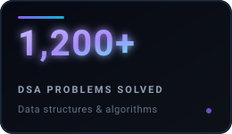</td>
    <td width="33%" align="center">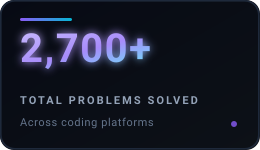</td>
    <td width="33%" align="center">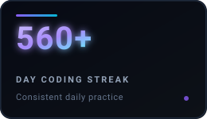</td>
  </tr>
  <tr>
    <td colspan="3" align="center">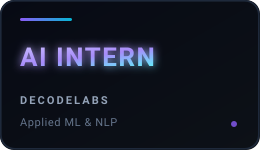</td>
  </tr>
</table>

<div align="center">

<p>
  <a href="https://leetcode.com/u/Nihal_555/"></a>
  <a href="https://www.codechef.com/users/kit28csb106"></a>
  <a href="https://www.hackerrank.com/profile/kit28_24bcs106"></a>
</p>

<sub>Problem counts are self-reported across coding platforms and are separate from GitHub contribution figures.</sub>

</div>

<p align="center"></p>

<div align="center"></div>
<br/>

<table width="100%">
  <tr>
    <td width="50%" align="center"></td>
    <td width="50%" align="center"></td>
  </tr>
  <tr>
    <td align="center"></td>
    <td align="center"></td>
  </tr>
</table>

<p align="center"></p>

<div align="center">


<br/>

<sub>Open to AI/ML engineering internships, MERN development roles and research-adjacent collaboration.</sub>

<p>
  <a href="https://linkedin.com/in/nihal-hussain-cse"></a>
  <a href="https://nihal-protfolio.vercel.app"></a>
  <a href="https://github.com/nihalhussain555"></a>
  <a href="mailto:nihalhussain587@gmail.com"></a>
</p>


</div>
